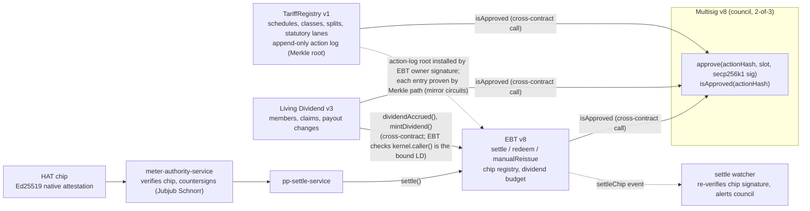

# PollPower contracts: preliminary review guide (branch `wi16-ledger9`)

This page is for an external reviewer. It says what the contracts do, what
changed for ledger 9, every security finding on this branch and the test that
attacks it, the trust assumptions we chose on purpose, how to run everything,
and the questions we have for Midnight.

Nothing on this branch is deployed to any public network. Every result below
comes from offline contract tests or from a local ledger 9 devnet.

## PollPower in one paragraph

PollPower is an energy economy for rural Kenya. Solar producers sell metered
electricity to neighbours; each sale is measured by a metering chip (the "HAT",
a TI CC1352P7 with an INA226 meter) and settled on Midnight as **EBT**
(Energy-Backed Token), minted in proportion to the chip-metered energy. A council-governed
**TariffRegistry** sets how each sale splits (producer, operations, DAO,
statutory levies, and a **Living Dividend** share). The Living Dividend pays an
equal share of that slice to every registered, KYC-verified community member,
who claims it in their own wallet. A pilot has run since May 2026 on Preview
with the previous generation of these contracts; this branch is the ledger 9
generation we intend to take to Preprod.

## How the contracts relate



- **Multisig v8** ([`multisig/multisig-v8-secp256k1.compact`](multisig/multisig-v8-secp256k1.compact)):
  council members sign with secp256k1 keys held on Tangem rings; `approve`
  verifies the signature in-circuit and records approvals per
  (action, slot, council epoch). It has no witnesses. Consumers keep their own
  replay sets, so an approval is consumed where it is used.
- **TariffRegistry v1** ([`tariff-registry/tariff-registry-v1.compact`](tariff-registry/tariff-registry-v1.compact)):
  every federation action needs a council approval of a hash that binds all
  its arguments and the registry's address. Each change is appended to an
  action log whose Merkle root EBT mirrors.
- **EBT v8** ([`ebt/ebt-v8.compact`](ebt/ebt-v8.compact); domain tags say
  `v9`, the file name kept `v8`): mints on `settle` from a countersigned chip
  attestation, splits each settle by the mirrored class split and lanes, keeps
  the dividend slice as an on-chain budget, and mints from that budget only
  when the bound Living Dividend contract asks.
- **Living Dividend v3** ([`living-dividend/living-dividend-v3.compact`](living-dividend/living-dividend-v3.compact)):
  members prove a Jubjub key with an in-circuit Schnorr signature; `claim`
  reads EBT's accrued total and calls `mintDividend`, so the member receives
  unshielded EBT in the same transaction. EBT never calls back into LD.

Designs: [auth fix design](docs/design/WI16-auth-fix-design.md),
[LD v3 design](docs/design/living-dividend-v3-design.md),
[HAT chip signing follow-up](docs/design/hat-chip-signing-followup.md).
Running status: [docs/STATUS.md](docs/STATUS.md),
[docs/findings-status.md](docs/findings-status.md).

## What changed for ledger 9

| Area | Before (Preview, v7.4.x / EBT v8 rollout) | On this branch |
|---|---|---|
| Toolchain | compactc 0.30.0 | Compact 0.36.1, language 0.28, compact-runtime 0.21.0, Midnight.js 5.0.1, ledger-v9 1.0.2, wallet SDK 2.0.1; devnet node 2.1.101, indexer 4.4.101, proof server 9.0.2 |
| Signature checks | `assert(disclose(witness(...)))`: the prover's own code said yes or no | Verified in-circuit: stdlib `secp256k1EcdsaVerify` (council), `jubjubSchnorrVerify` (owner, meter authority, escrow attestor, schedule validator and operators, LD members) |
| Council | each contract asked a witness whether the council had approved | Cross-contract `isApproved` on Multisig v8, with a local consumed-action set in every consumer |
| Initialization | exported `initialize`, first caller wins | Every authority set in the constructor |
| Living Dividend | off-chain pool wallet, keeper, batch payer | Member claims mint directly through an LD → EBT cross-contract call |
| History | ledger maps used as logs | Contract events (`Misc`): `pp:ld:v3:*`, `pp:ebt:v9:settleChip` |
| Deploy | ceremony-fenced deploy, deployer key left live | Staged deploy, then one maintenance update that inserts the last verifier key **and locks the maintenance authority**; a checker confirms the on-chain operations equal the audited build |
| Tooling | per-script endpoints | All endpoints from environment variables; nothing hardcoded |

Deploy sizes under the ledger 9 cost model (50,000 `bytesWritten` per block,
measured with [`tooling/measure/measure-deploy-cost-l9.mjs`](tooling/measure/measure-deploy-cost-l9.mjs)):

| Contract | Full deploy | Staged deploy | Each verifier-key insert |
|---|---|---|---|
| Multisig v8 (5 keys) | 22.8% | not needed | 5.7% |
| TariffRegistry v1 (18) | 85.5% | 32.1% | 4.9% |
| EBT v8 (21) | **104.2%** | 36.0% | 4.9% |
| LD v3 (10) | 44.3% | not needed | 4.8% |

## Findings and fixes

IDs starting `WI16-` were found during this migration. Every fix was written
test-first: the attack (usually the original proof of concept) is a test that
failed on the old build and is rejected on the new one. Test files are in
[`tests/contract/`](tests/contract/) and [`tests/parity/`](tests/parity/).
Severities are ours; "not rated" means the item came from a design review or
decision rather than an exploit. The README's older "Audit (2026-06-10)"
section uses its own IDs (its C-1, C-2 and H-1 are different, earlier items).

| ID | Severity | Finding | Fix | Attack tests |
|---|---|---|---|---|
| **WI16-C-1** (council) | Critical | Every council check was `assert(disclose(witness()))`. A submitter supplies its own witness, so forged signatures reached quorum (reproduced at runtime on Multisig v6.2). | Multisig v8 verifies secp256k1 in-circuit, has no witnesses; EBT and TariffRegistry call `isApproved` and keep replay records | [`c1-council-v8`](tests/contract/c1-council-v8.test.mjs) PoC-1, C1-1..C1-12; [`c1b-ebt-council`](tests/contract/c1b-ebt-council.test.mjs) C1b-EBT-1..8; [`c1b-tariff-council`](tests/contract/c1b-tariff-council.test.mjs) C1b-TR-1..6 |
| **WI16-C-1** (machine signers) | Critical | Same pattern for the HAT settle signature, reissue co-signature, escrow attestation, schedule validator and operator | Jubjub Schnorr verified in-circuit over exported pure-circuit messages bound to the contract address | [`c1c-ebt-machine-signers`](tests/contract/c1c-ebt-machine-signers.test.mjs) S1..S6, M1..M5, R1..R5, P1; [`c1c-tariff-signers`](tests/contract/c1c-tariff-signers.test.mjs) V1..V6, O1..O4 |
| **WI16-C-1** (Living Dividend) | Critical | Member and council checks in LD v2.x were witnesses | LD v3: member Schnorr in-circuit, council `isApproved` | [`ld3-living-dividend`](tests/contract/ld3-living-dividend.test.mjs) LD3-A1..A8, P2, R2, R3 |
| **WI16-C-2** | Critical | EBT owner gate compared `ownPublicKey()` (a witness) with public state; with C-1 this was an unprivileged mint | Owner is a Jubjub key; Schnorr over (contract, circuit, argument digest, nonce), computed in-circuit | [`c2-owner-schnorr`](tests/contract/c2-owner-schnorr.test.mjs) C2-0..C2-7 |
| **WI16-H-1** | High | EBT v8 and Multisig v6.2 `initialize` could be front-run; the first caller became owner | `initialize` removed; constructor sets every authority | [`h1-constructor-init`](tests/contract/h1-constructor-init.test.mjs) H1-MS-1..3; C1-11, C1-12 |
| **WI16-E-1** | High | `settle` took the dividend / ops / DAO shares as free arguments; any HAT holder could zero the dividend | Class split mirrored whole; settle must use it (`SPLIT_OFF_CLASS`) | [`ld3-ebt-side`](tests/contract/ld3-ebt-side.test.mjs) WI16-E-1 |
| **WI16-E-2** | High | Registry mirror writes were not monotonic; replaying an older log entry rolled a class split back or revived a retired schedule | Per-item `actionSeq`, strictly increasing (`MIRROR_STALE_ENTRY`) | `ld3-ebt-side` WI16-E-2a/b/c |
| **WI16-E-3** | Medium | `EventProof.actionSeq` was not tied to the Merkle path | Leaf index rebuilt from the path bits must equal `actionSeq` | `ld3-ebt-side` WI16-E-3 |
| **WI16-T-2** (TariffRegistry operator) | High | The council-approved `registerSchedule` hash left out the operator key and reference rate, and the validator key was a free argument: whoever submitted an approved registration first chose the schedule's operator and rate | Approval hash binds operator key id and reference rate; validator key pinned in the ledger, rotated only by the council | [`c1c-tariff-signers`](tests/contract/c1c-tariff-signers.test.mjs) V3 (front-run), V6 |
| Reissue co-signature binding | not rated | The meter authority's reissue co-signature did not bind the recipient address or the contract | Both bound | `c1c-ebt-machine-signers` M3, M4 |
| Gap C: `manualReissue` | not rated (design decision) | Reissue needed only owner + meter authority | Also needs 2-of-3 council approval of every argument, with a replay record | `c1c-ebt-machine-signers` RC1..RC5; [`owner-tooling`](tests/contract/owner-tooling.test.mjs) OWN-1, OWN-2 |
| HAT `SIGN_HASH` | not rated (design decision) | Production settles used a chip command that signs any host-supplied hash, so the host chose the amount | Settle carries the chip's native attestation (its own metered µWh, uptime, TRNG nonce); circuit asserts `amount == floor(µWh / 1000)`; meter-authority-service accepts only native attestations | `c1c-ebt-machine-signers` S3b, S3c, S8 |
| Chip allowlist and nonce replay off-chain only | not rated (design decision) | A chip row added in the service database could mint; nonce replay was checked only off-chain | Council-gated on-chain chip registry enforced in `settle`; used-chip-nonce set | [`chip-registry`](tests/contract/chip-registry.test.mjs) CR-1..CR-6 |
| TariffRegistry retire at epoch 0 | Low | `retiredEpoch = 0` read as live, so a retirement before the first epoch advance did nothing | Retire refused until the first epoch advance | [`tr-retire-epoch0`](tests/contract/tr-retire-epoch0.test.mjs) TR-E0-1..3 |
| Statutory lane bypass | (hardening) | A settle must pay every live statutory lane of its class | Lane mirrored from the council-approved registry entry; settle refused if it drops or shorts a lane | [`statutory-lane`](tests/contract/statutory-lane.test.mjs) LN-1..LN-4 |
| LD-H-3 | High | v2.2.2's keeper gate on `bumpOnMint` was itself a witness | `bumpOnMint` and the keeper removed; LD reads accrual from EBT | `ld3-ebt-side` LD3-EBT-D0..D6 |
| Maintenance authority | not rated (operational; a standing backdoor if left unlocked) | `deployContract` leaves a one-key maintenance authority that can replace any circuit's verifier key at any time | Staged deploy ends with one update that inserts the last key and locks the authority; `checkFinalized()` requires on-chain operations to equal the audited build and the authority to be unable to sign | [`finalize-check`](tests/contract/finalize-check.test.mjs) FZ-1..FZ-6; devnet SD-1..SD-12 (below) |
| Event payload trimming | not rated (tooling) | The runtime drops trailing zero bytes of event payloads, so a naive reader verifies the wrong bytes | One codec restores each event to its exact layout length, refuses longer data and unknown framing | [`settle-watcher`](tests/contract/settle-watcher.test.mjs) W-4, W-5, W-6 |
| WI16-T-1 | Medium (test gap) | The JS mirror encoded integers big-endian; circuits are little-endian, so mirror tests only checked themselves | Mirror fixed; parity tests compare the compiled circuits with the off-chain code | [`ebt-v8.parity`](tests/parity/ebt-v8.parity.test.mjs) EBT-1, EBT-2; [`tariff-registry.parity`](tests/parity/tariff-registry.parity.test.mjs) TR-1 |

**Staged-deploy window attacks on the devnet** (stage `attacks` in
[`tooling/devnet/stack.mjs`](tooling/devnet/stack.mjs), 12/12 in the passing
run): a mid-deploy EBT fails the finalized check (SD-1); a circuit not yet
inserted cannot be called (SD-2, refused by Midnight.js client-side); settle
during the window fails because no chip can be registered yet (SD-3); an
outsider inserting or removing keys, or taking the authority, is rejected
(SD-4..SD-8); after finalize-and-lock even the deployer key and an unsigned
update are rejected (SD-9..SD-12).

**Still open, and gating Preprod:** council rotation in Multisig v8 (designed,
72 h delay, not implemented; the council is sealed for now); SD-2 confirmed at
the node with a raw transaction, not only client-side; HAT firmware with
`SIGN_HASH` disabled for settles; real ring keys in the Multisig v8
constructor; EBT reading the TariffRegistry root on chain (trust assumption
#5 below). The full gate list is in [docs/STATUS.md](docs/STATUS.md),
"Preprod gates".

## Trust assumptions we chose

These are deliberate. We would rather state them than have them found.

1. **The meter authority countersigns chip readings until chips sign a curve
   the circuit can verify.** The HAT chip signs Ed25519, which ledger 9 cannot
   verify in-circuit. meter-authority-service checks the chip's signature and
   rules, then countersigns with a Jubjub key that `settle` verifies. So the
   on-chain proof vouches for the service, not the chip. What limits a stolen
   service key: the chip must be registered on chain by the council and bound
   to this meter, producer and payout address; the amount must equal the
   attested energy; each session and chip nonce settles once; and every settle
   emits the chip's key, signature and reading, which an off-chain **settle
   watcher** re-verifies and alerts the whole council on any mismatch
   ([runbook](docs/runbooks/hat-settle-watcher.md)). Moving the chip to
   secp256k1 is tracked in the
   [follow-up](docs/design/hat-chip-signing-followup.md).
2. **Dividend payouts are unshielded.** Claims mint unshielded EBT to the
   member's payout address, so payouts and balances are public. Shielded
   payouts need shielded minting from a callee and a shielded claim flow in
   the consumer app; out of scope for this phase.
3. **Contracts are locked after deploy.** The maintenance authority is locked
   at the end of every deploy, so no circuit can be changed afterwards.
   Upgrades are a new contract version plus a council-approved migration.
   Consequence we accept: LD is bound to EBT once, so replacing LD means a new
   EBT (or a new, carefully designed rebind circuit).
4. **USB-attached infrastructure, for now.** Our self-hosted Midnight node,
   indexer and proof server, and the HAT gateways, currently run on small
   machines with USB-attached hardware rather than redundant hosted
   infrastructure. This affects availability and durability, not what the
   contracts accept: every authorization is checked in-circuit, and the
   watcher reads events from the indexer independently.
5. **The EBT owner key vouches for the TariffRegistry root it mirrors.** EBT
   does not call the registry; the owner signs each action-log root install,
   and individual entries (class splits, lanes, schedules) are then proven
   against that root by Merkle path, monotonically. Anchoring roots to
   registry state on chain is deferred
   (see the trust-model comment above `mirrorActionLogRoot` in
   [`ebt/ebt-v8.compact`](ebt/ebt-v8.compact)).
   **The fix is designed and scheduled** before any Preprod deploy
   ([design](docs/design/registry-root-anchor-design.md)): EBT will read the
   root from the TariffRegistry through a cross-contract call to a new
   witness-free view circuit, the same pattern as LD v3 reading EBT's
   `dividendAccrued()`, and no key will be able to install a root. This is
   possible because the TariffRegistry is not deployed yet, so it can still
   gain the view circuit.
6. **The proof server sees private inputs.** That is why owner, member and
   machine identities are Schnorr keys (the prover sees one single-use
   signature) rather than hash-preimage secrets.

## How to run it

Requirements: Node 22, the Compact toolchain at 0.36.1 (on Windows, the WSL
shim described in [`tooling/build-contracts.mjs`](tooling/build-contracts.mjs)).

```sh
npm ci
npm run build:contracts      # compiles the ledger 9 contracts to build/l9 (--skip-zk; --zk for keys)
npm test                     # mirror suites, parity tests, contract tests (offline, no network)
npm run typecheck
```

The contract tests run the compiled circuits with compact-runtime, including
cross-contract calls, with real signatures. They need no network or proof
server. Last recorded run: contract + parity 136/136, mirror 133/133,
typecheck clean ([docs/STATUS.md](docs/STATUS.md)).

**Devnet pass** (a local ledger 9 devnet: node, indexer, proof server;
[`tooling/devnet/compose.yml`](tooling/devnet/compose.yml)):

```sh
node tooling/devnet/stack.mjs all
```

`all` runs every stage from fresh state and refuses to start if state exists:
council, tariff (staged deploy and lock), ebt (staged deploy and lock, chip
registration), settle, ld (deploy, bind, register), settle, claim (mint inside
the cross-contract call), service (settle-service submit and crash replay),
relay (LD relayer), watcher (forged chip signature alerts all council members),
attacks (SD-1..SD-12). It writes a record with the git commit, the hashes of
every build and of the deploy code, and the per-stage result to
[`docs/devnet-passes/`](docs/devnet-passes/). The Preprod ceremony script
refuses builds or deploy code that differ from a passing record.

**Passing record:**
[`docs/devnet-passes/2026-11-25T05-42-47-913Z-pass.json`](docs/devnet-passes/2026-11-25T05-42-47-913Z-pass.json)
(commit `08c94b8`, clean tree, 67 min, all 11 stages including the statutory
lane, attacks 12/12). The first pass, before the lane was added, is
[`2026-11-24T12-57-05-537Z-pass.json`](docs/devnet-passes/2026-11-24T12-57-05-537Z-pass.json)
(`7177dd1`). The two `-fail` records between them failed in the proof server
(memory), not in the contracts; since then the proof server is restarted
before every proof.

## Questions for Midnight's team

1. **Shielded cross-contract calls.** When can a callee mint or send
   *shielded* tokens inside a cross-contract call? It decides when dividend
   payouts can become private.
2. **`kernel.caller()` and minting in callees.** On our devnet, `mintDividend`
   reached through LD → EBT read `kernel.caller()` correctly and its
   `mintUnshieldedToken` produced the UTXO, and two calls to EBT in one
   transaction worked. Is this supported, stable behaviour we can rely on for
   Preprod and mainnet? Is `kernel.caller()` reliable on the contract-to-contract
   path specifically (the stdlib warns about top-level calls)?
3. **ECDSA high-S.** `secp256k1EcdsaVerify` accepts both `(r, s)` and
   `(r, n − s)`. We record approvals per (action, slot), never per signature,
   so malleability does not matter to us. Is accepting high-S intended, and
   will it stay that way? A change to low-S-only would not break us but we
   would like to know.
4. **Staged deploy size.** EBT is 104% of a block as one deploy, so it can only
   go out staged (36% plus 14 verifier-key inserts of ~5% each), then locked.
   Is staged deploy plus lock the pattern you recommend, are larger deploys or
   batched verifier-key inserts planned, and is there a better way to keep the
   contract inert during the window (today the ceremony circuits are callable)?
5. **Proof memory and time.** Our largest proofs take about 10 GB of memory and
   about 5 minutes each on 4 cores, and the proof server kept memory across
   proofs until we restarted it before each proof. What memory and time should
   we budget per proof, is the growth across proofs expected, and are there
   proof-server settings we should use?
6. **Indexer and archive node.** Does indexer 4.x need its node to be an
   archive node (full state history), or does a pruned node work for
   contract-event and state queries from deploy onwards?
7. (smaller) Event payloads lose trailing zero bytes in the runtime's value
   encoding; we restore them by layout. Is that intended? And should a node
   reject a raw transaction calling a circuit whose verifier key is not yet
   inserted (our SD-2 is only checked client-side so far)?
